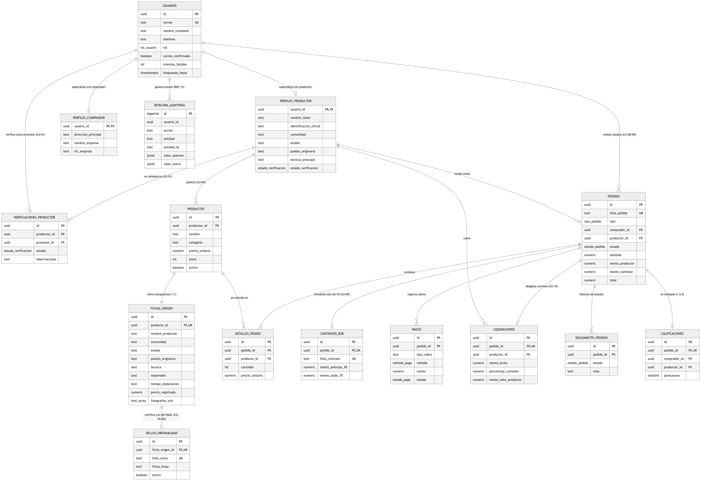
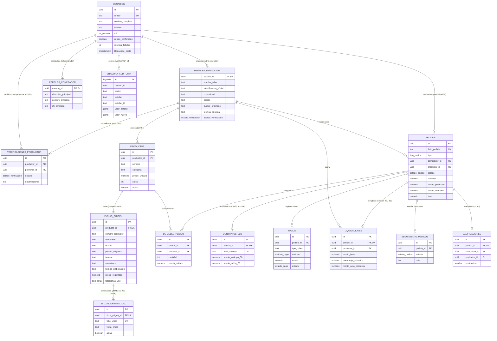

# Modelo Entidad-Relación · RaicesMX

**Proyecto:** RaicesMX — Plataforma de comercialización directa para productores originarios
**Equipo 10 · Facultad de Ciencias de la Computación, BUAP · Otoño 2026**
**Implementación:** [`supabase/migrations/001_initial_schema.sql`](../supabase/migrations/001_initial_schema.sql) · **Datos de prueba:** [`supabase/seed.sql`](../supabase/seed.sql)

---

## 1. Diagrama E-R

Versión en imagen para el reporte: [`modelo-er.png`](modelo-er.png) · [`modelo-er.svg`](modelo-er.svg) (el SVG no pierde calidad al hacer zoom).

Versión editable (GitHub la dibuja sola):

## 2. Explicación de las relaciones

| Relación | Cardinalidad | Regla de integridad | Justificación |
| :--- | :---: | :--- | :--- |
| `usuarios` → `perfiles_productor` | 1 : 0..1 | PK compartida, `ON DELETE CASCADE` | Especialización por rol: la cuenta es una sola y el perfil agrega los datos del taller. |
| `usuarios` → `perfiles_comprador` | 1 : 0..1 | PK compartida, `ON DELETE CASCADE` | Igual que el anterior para compradores B2C y B2B. |
| `perfiles_productor` → `verificaciones_productor` | 1 : N | `ON DELETE CASCADE` | Un productor puede tener varias visitas (rechazo y nueva revisión). Queda el historial. |
| `usuarios` (promotor) → `verificaciones_productor` | 1 : N | `ON DELETE RESTRICT` | No se puede borrar a un promotor que ya firmó verificaciones. |
| `perfiles_productor` → `productos` | 1 : N | `ON DELETE RESTRICT` | Un productor con piezas publicadas o vendidas no puede desaparecer. |
| `productos` → `fichas_origen` | 1 : 1 | `UNIQUE` + `ON DELETE CASCADE` | Composición: la ficha no existe sin su pieza y toda pieza exige ficha (RF-04). |
| `fichas_origen` → `sellos_originalidad` | 1 : 0..1 | `UNIQUE` + `ON DELETE CASCADE` | Cada ficha recibe a lo más un sello; su firma HMAC depende de los datos de la ficha. |
| `usuarios` (comprador) → `pedidos` | 1 : N | `ON DELETE RESTRICT` | Conserva la trazabilidad fiscal de cada compra. |
| `perfiles_productor` → `pedidos` | 1 : N | `ON DELETE RESTRICT` | Un pedido es de un solo productor; un carrito mixto genera un pedido por productor. |
| `pedidos` → `detalles_pedido` | 1 : 1..N | `ON DELETE CASCADE`, `UNIQUE(pedido, producto)` | Partidas del pedido con el precio congelado al momento de comprar. |
| `productos` → `detalles_pedido` | 1 : N | `ON DELETE RESTRICT` | No se borra una pieza que ya se vendió. |
| `pedidos` → `contratos_b2b` | 1 : 0..1 | `UNIQUE` + `ON DELETE CASCADE` | Solo los pedidos B2B tienen contrato con pago escalonado 30/70. |
| `pedidos` → `pagos` | 1 : N | `ON DELETE CASCADE` | B2C tiene un cobro; B2B tiene anticipo (30%) y saldo (70%). |
| `pedidos` → `liquidaciones` | 1 : 0..1 | `UNIQUE` + `ON DELETE CASCADE` | Registro de la comisión (10% B2C / 5% B2B) y del neto que se le paga al productor. |
| `pedidos` → `seguimiento_pedidos` | 1 : N | `ON DELETE CASCADE` | Historial de cambios de estado (confirmado → enviado → entregado). |
| `pedidos` → `calificaciones` | 1 : 0..1 | `UNIQUE` | Una sola calificación por pedido. |
| `usuarios` → `bitacora_auditoria` | 1 : N | Sin FK (lógica) | La bitácora conserva eventos aunque el usuario se elimine; es inmutable por trigger. |

## 3. Tipos enumerados

| Tipo | Valores |
| :--- | :--- |
| `rol_usuario` | `productor`, `promotor`, `comprador_b2c`, `comprador_b2b`, `admin` |
| `estado_verificacion` | `pendiente`, `aprobado`, `rechazado` |
| `tipo_pedido` | `B2C`, `B2B` |
| `estado_pedido` | `pendiente_aprobacion`, `rechazado_productor`, `expirado`, `pendiente_anticipo`, `confirmado`, `en_produccion`, `enviado`, `entregado`, `cancelado` |
| `metodo_pago` | `tarjeta`, `spei` |
| `estado_pago` | `pendiente`, `aprobado`, `rechazado`, `reembolsado` |

## 4. Diccionario de datos

Convenciones: **PK** llave primaria · **FK** llave foránea · **UK** único · **NN** no nulo. Todas las fechas son `timestamptz` con `default now()`.

### 4.1 `usuarios`
| Columna | Tipo | Restricciones | Descripción |
| :--- | :--- | :--- | :--- |
| id | uuid | PK, default `gen_random_uuid()` | Identificador; se puede ligar con `auth.users` de Supabase. |
| correo | text | UK, NN, CHECK formato | Correo de acceso. |
| nombre_completo | text | NN, CHECK no vacío | Nombre de la persona. |
| telefono | text | | Teléfono de contacto. |
| rol | rol_usuario | NN | Rol dentro de la plataforma. |
| correo_confirmado | boolean | NN, default false | Confirmación del correo (RF-02). |
| intentos_fallidos | int | NN, default 0, CHECK ≥ 0 | Contador para el bloqueo tras 5 intentos (RF-02). |
| bloqueado_hasta | timestamptz | | Fin del bloqueo de 15 minutos. |
| created_at / updated_at | timestamptz | NN | `updated_at` se actualiza por trigger. |

### 4.2 `perfiles_productor` (CU-01)
| Columna | Tipo | Restricciones | Descripción |
| :--- | :--- | :--- | :--- |
| usuario_id | uuid | PK, FK → usuarios.id CASCADE | Cuenta a la que pertenece el perfil. |
| nombre_taller | text | NN | Nombre del taller o grupo artesanal. |
| identificacion_oficial | text | NN | CURP o clave de elector del INE (validada en la API). |
| comunidad | text | NN | Comunidad de origen. |
| estado | text | NN, índice | Entidad federativa. |
| pueblo_originario | text | NN | Pueblo originario (Nahua, Mixteco, etc.). |
| tecnica_principal | text | NN | Técnica artesanal principal. |
| rfc | text | | RFC para facturación. |
| clabe_spei | text | CHECK 18 dígitos | Cuenta para liquidaciones. |
| estado_verificacion | estado_verificacion | NN, default `pendiente`, índice | Solo `aprobado` puede publicar. |
| promedio_calificacion | numeric(3,2) | NN, CHECK 0–5 | Promedio de calificaciones. |
| created_at | timestamptz | NN | Fecha de registro. |

### 4.3 `verificaciones_productor` (CU-01)
| Columna | Tipo | Restricciones | Descripción |
| :--- | :--- | :--- | :--- |
| id | uuid | PK | |
| productor_id | uuid | FK → perfiles_productor CASCADE, NN | Productor visitado. |
| promotor_id | uuid | FK → usuarios RESTRICT, NN | Promotor que verificó. |
| estado | estado_verificacion | NN | Resultado de la visita. |
| observaciones | text | | Notas de campo. |
| evidencia_url | text | | Foto o documento de evidencia. |
| fecha_verificacion | timestamptz | NN | |

### 4.4 `perfiles_comprador`
| Columna | Tipo | Restricciones | Descripción |
| :--- | :--- | :--- | :--- |
| usuario_id | uuid | PK, FK → usuarios CASCADE | |
| direccion_principal | text | | Dirección de entrega habitual. |
| nombre_empresa | text | | Solo compradores B2B. |
| rfc_empresa | text | | Solo compradores B2B. |
| created_at | timestamptz | NN | |

### 4.5 `productos` (CU-04, CU-07)
| Columna | Tipo | Restricciones | Descripción |
| :--- | :--- | :--- | :--- |
| id | uuid | PK | |
| productor_id | uuid | FK → perfiles_productor RESTRICT, NN, índice | Autor de la pieza. |
| nombre | text | NN, CHECK no vacío | Nombre comercial. |
| descripcion | text | | |
| categoria | text | NN, CHECK ∈ {Textiles, Cerámica y barro, Palma y madera} | Categoría del catálogo. |
| precio_unitario | numeric(10,2) | NN, CHECK > 0 | Precio de venta al público en MXN. |
| stock | int | NN, default 1, CHECK ≥ 0 | Existencias; se descuentan con bloqueo `FOR UPDATE`. |
| lotes_habilitados | boolean | NN, default true | Si acepta pedidos B2B. |
| activo | boolean | NN, default true | Visible en catálogo. |
| created_at / updated_at | timestamptz | NN | |

### 4.6 `fichas_origen` (CU-04 · los 9 campos de RF-04)
| Columna | Tipo | Restricciones | Descripción |
| :--- | :--- | :--- | :--- |
| id | uuid | PK | |
| producto_id | uuid | UK, FK → productos CASCADE, NN | Composición 1:1. |
| nombre_productor | text | NN, CHECK no vacío | **Campo 1** |
| comunidad | text | NN, CHECK no vacío | **Campo 2** |
| estado | text | NN, CHECK no vacío, índice | **Campo 3** |
| pueblo_originario | text | NN, CHECK no vacío, índice | **Campo 4** |
| tecnica | text | NN, CHECK no vacío, índice | **Campo 5** |
| materiales | text | NN, CHECK no vacío | **Campo 6** |
| tiempo_elaboracion | text | NN, CHECK no vacío | **Campo 7** |
| precio_registrado | numeric(10,2) | NN, CHECK > 0 | **Campo 8** |
| fotografias_urls | text[] | NN, CHECK al menos 1 | **Campo 9** (JPG/PNG/WEBP ≤ 5 MB) |
| historia_pieza | text | | Relato de la pieza. |
| latitud / longitud | numeric(9,6) | CHECK rango válido | Georreferencia opcional. |
| version | int | NN, default 1 | Versión de la ficha. |
| capturado_por | uuid | FK → usuarios SET NULL | Productor o promotor que capturó. |
| updated_at | timestamptz | NN | |

### 4.7 `sellos_originalidad` (CU-05, CU-06)
| Columna | Tipo | Restricciones | Descripción |
| :--- | :--- | :--- | :--- |
| id | uuid | PK | |
| ficha_origen_id | uuid | UK, FK → fichas_origen CASCADE, NN | Ficha certificada. |
| folio_unico | text | UK, NN, CHECK `^RMX-[A-Z]{3}-\d{4}-[0-9A-F]{6}$` | Ej. `RMX-PUE-2026-9A4F2C`. |
| firma_hmac | text | NN, CHECK 64 hex | HMAC-SHA256 de `folio\|producto\|productor\|comunidad\|pueblo\|técnica`. |
| qr_png_url / qr_pdf_url | text | | Descarga del QR. |
| activo | boolean | NN, default true | Permite revocar un sello. |
| fecha_emision | timestamptz | NN | |

### 4.8 `pedidos` (CU-08, CU-09)
| Columna | Tipo | Restricciones | Descripción |
| :--- | :--- | :--- | :--- |
| id | uuid | PK | |
| folio_pedido | text | UK, NN | Ej. `PED-2026-1A2B3C4D`. |
| tipo | tipo_pedido | NN | B2C o B2B. |
| comprador_id | uuid | FK → usuarios RESTRICT, NN | |
| productor_id | uuid | FK → perfiles_productor RESTRICT, NN | |
| estado | estado_pedido | NN, default `confirmado` | |
| direccion_entrega | text | NN | |
| cantidad_total | int | NN, CHECK > 0; B2B entre 5 y 50 | Piezas del pedido. |
| porcentaje_descuento | numeric(5,2) | NN, CHECK 0–100 | Descuento por volumen B2B. |
| subtotal | numeric(12,2) | NN | Suma de partidas. |
| monto_descuento | numeric(12,2) | NN, default 0 | |
| costo_envio | numeric(10,2) | NN, default 0 | Lo paga el comprador; no lleva comisión. |
| total | numeric(12,2) | NN | Subtotal − descuento + envío. |
| monto_productor | numeric(12,2) | NN | 90% (B2C) o 95% (B2B). |
| monto_comision | numeric(12,2) | NN | 10% (B2C) o 5% (B2B). |
| numero_guia | text | | Paquetería. |
| expira_aprobacion_en | timestamptz | | Límite para que el productor acepte un lote. |
| created_at / updated_at | timestamptz | NN | |
| — | — | CHECK `monto_productor + monto_comision = subtotal − monto_descuento` | El reparto siempre cuadra. |

### 4.9 `detalles_pedido`
| Columna | Tipo | Restricciones | Descripción |
| :--- | :--- | :--- | :--- |
| id | uuid | PK | |
| pedido_id | uuid | FK → pedidos CASCADE, NN | |
| producto_id | uuid | FK → productos RESTRICT, NN | |
| cantidad | int | NN, CHECK > 0 | |
| precio_unitario | numeric(10,2) | NN, CHECK > 0 | Precio congelado al comprar. |
| subtotal | numeric(12,2) | NN, CHECK = cantidad × precio | |

### 4.10 `contratos_b2b` (CU-09)
| Columna | Tipo | Restricciones | Descripción |
| :--- | :--- | :--- | :--- |
| id | uuid | PK | |
| pedido_id | uuid | UK, FK → pedidos CASCADE | |
| folio_contrato | text | UK, NN | |
| monto_anticipo_30 | numeric(12,2) | NN, CHECK > 0 | 30% al firmar. |
| monto_saldo_70 | numeric(12,2) | NN, CHECK > 0 | 70% contra entrega. |
| plazo_entrega_dias | int | NN, CHECK > 0 | |
| condiciones_calidad | text | NN | |
| pdf_url | text | | Contrato en PDF. |
| aceptado_en | timestamptz | | |

### 4.11 `pagos`
| Columna | Tipo | Restricciones | Descripción |
| :--- | :--- | :--- | :--- |
| id | uuid | PK | |
| pedido_id | uuid | FK → pedidos CASCADE, NN | |
| tipo_cobro | text | NN, CHECK ∈ {total_b2c, anticipo_30_b2b, saldo_70_b2b} | |
| metodo | metodo_pago | NN | |
| monto | numeric(12,2) | NN, CHECK > 0 | |
| estado | estado_pago | NN, default `aprobado` | |
| token_pasarela | text | | Referencia de la pasarela (de prueba en v1). |
| created_at | timestamptz | NN | |

### 4.12 `liquidaciones` (CU-10, RF-12)
| Columna | Tipo | Restricciones | Descripción |
| :--- | :--- | :--- | :--- |
| id | uuid | PK | |
| pedido_id | uuid | UK, FK → pedidos CASCADE | |
| productor_id | uuid | FK → perfiles_productor RESTRICT | |
| monto_bruto | numeric(12,2) | NN | Venta sin envío. |
| porcentaje_comision | numeric(5,2) | NN, CHECK ∈ {5, 10} | |
| monto_comision_plataforma | numeric(12,2) | NN | |
| retencion_isr / retencion_iva | numeric(12,2) | NN, default 0 | Retenciones fiscales. |
| monto_neto_productor | numeric(12,2) | NN | Lo que se transfiere al productor. |
| fecha_programada | date | NN, índice parcial | Fecha de pago (7 días en B2C). |
| liquidado | boolean | NN, default false | |
| created_at | timestamptz | NN | |

### 4.13 `seguimiento_pedidos`
| Columna | Tipo | Restricciones | Descripción |
| :--- | :--- | :--- | :--- |
| id | uuid | PK | |
| pedido_id | uuid | FK → pedidos CASCADE, NN | |
| estado | estado_pedido | NN | Estado alcanzado. |
| nota | text | | |
| creado_por | uuid | FK → usuarios SET NULL | |
| created_at | timestamptz | NN | |

### 4.14 `calificaciones`
| Columna | Tipo | Restricciones | Descripción |
| :--- | :--- | :--- | :--- |
| id | uuid | PK | |
| pedido_id | uuid | UK, FK → pedidos CASCADE | |
| comprador_id | uuid | FK → usuarios RESTRICT | |
| productor_id | uuid | FK → perfiles_productor CASCADE | |
| puntuacion | smallint | NN, CHECK 1–5 | Estrellas. |
| comentario | text | | |
| created_at | timestamptz | NN | |

### 4.15 `bitacora_auditoria` (RNF-13)
| Columna | Tipo | Restricciones | Descripción |
| :--- | :--- | :--- | :--- |
| id | bigserial | PK | Orden cronológico. |
| usuario_id | uuid | | Quién hizo la acción. |
| rol | text | | Rol en ese momento. |
| accion | text | NN | Ej. `verificar_productor`, `publicar_pieza`, `crear_pedido_b2c`. |
| entidad / entidad_id | text | NN, índice | Registro afectado. |
| ip_origen | text | | |
| valor_anterior / valor_nuevo | jsonb | | Estado antes y después. |
| fecha | timestamptz | NN, índice | |

Triggers `trg_bitacora_inmutable` (BEFORE UPDATE OR DELETE) y `trg_bitacora_sin_truncate` (BEFORE TRUNCATE) lanzan una excepción: la tabla solo admite `INSERT`.

## 5. Objetos adicionales de la base

| Objeto | Tipo | Uso |
| :--- | :--- | :--- |
| `vista_catalogo` | Vista | Producto + ficha + sello de piezas activas, con existencias y de productores aprobados (CU-07). |
| `vista_mapa_procedencia` | Vista | Productores aprobados y piezas por estado (RF-08). |
| `crear_pedidos_b2c(comprador, dirección, items, envío)` | Función PL/pgSQL | Compra transaccional: bloquea los productos con `FOR UPDATE` en orden de id, valida existencias, crea un pedido por productor con su detalle, pago, liquidación 90/10, seguimiento y bitácora. Si una pieza no alcanza, revierte todo. |
| `fijar_updated_at()` | Trigger | Mantiene `updated_at` en usuarios, productos, fichas y pedidos. |
| `fotos-piezas` | Bucket de Storage | Fotografías públicas, límite 5 MB y tipos JPG/PNG/WEBP. |
| RLS | Seguridad | Activado en las 15 tablas sin políticas para `anon`: la única puerta es la API REST del servidor. |

## 6. Reglas extra (archivo 002)

Archivo: [`supabase/migrations/002_reglas_extra.sql`](../supabase/migrations/002_reglas_extra.sql)

Después de terminar las tablas agregué un segundo archivo con reglas para que la base se cuide sola, aunque alguien meta datos sin pasar por la página. No cambia ninguna tabla de la 001, solo agrega cosas encima.

| Qué agregué | Para qué sirve |
| :--- | :--- |
| Búsqueda sin acentos | Si alguien escribe "ceramica" encuentra "Cerámica". |
| Solo productores aprobados publican | Si un productor sigue "pendiente", la base no le deja guardar piezas. |
| Historial automático de pedidos | Cada vez que un pedido cambia de estado (enviado, entregado...) se anota solo en `seguimiento_pedidos`. |
| Promedio de estrellas automático | Cuando alguien califica, se recalcula solo el promedio del productor. |
| Columna `auth_id` en `usuarios` | Queda lista para conectar el inicio de sesión de Supabase (CU-02). |
| Descripción de cada tabla | Al abrir una tabla en Supabase aparece qué guarda. |
| Ajustes de seguridad y velocidad | Supabase marca unos avisos si faltan; con esto ya no aparecen. |
